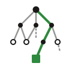
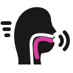

  <picture>
    <source media="(prefers-color-scheme: dark)" srcset="https://raw.githubusercontent.com/lowmagic/.github/main/profile/assets/lowmagic-lockup-dark.svg">
    
  </picture>

Bounded AI systems and diagnostic tools by [Nathan Curry](https://nathancurry.com) ([LinkedIn](https://www.linkedin.com/in/nathandcurry)): OpenShift escalation and root-cause engineering at Red Hat.

Everything here is built on the same [principles](https://github.com/lowmagic/.github/blob/main/PRINCIPLES.md): use what's already in the stack, keep hard seams between layers, and separate evidence from inference. The [code standards](https://github.com/lowmagic/.github/blob/main/code-standards/README.md) turn them into rules that each repo syncs and checks in CI and review.

## Support-case triage

Segmented tools and narrow models for investigating diagnostic archives without putting raw dumps in context. None of them diagnose: the engineer draws the conclusions.

| Project | What it is | Worth a look |
| --- | --- | --- |
| <picture><source media="(prefers-color-scheme: dark)" srcset="https://raw.githubusercontent.com/lowmagic/.github/main/profile/assets/compa-mark-dark.svg"></picture> [compa](https://github.com/lowmagic/compa) | Terminal chat companion in Go for investigating support cases and diagnostic archives. | Works with smaller, enterprise-hosted, and zero-data-retention (ZDR) models, redacts secrets on the host, and ties every claim to a case file |
| ↳ [compa-engine](https://github.com/lowmagic/compa-engine) | Go runtime behind `compa` that runs tool sandboxes, loads digest-pinned expert bundles, and verifies citations. | Cache-stable conversation ordering, network-off sandboxing, and post-turn evidence checks ([spec](https://github.com/lowmagic/compa-engine/blob/main/docs/SPEC.md), [architecture](https://github.com/lowmagic/compa-engine/blob/main/docs/ARCHITECTURE.md)) |
| ↳ [compa-experts](https://github.com/lowmagic/compa-experts) | Domain experts, shared file-inspection tool catalogs, and case routing rules embedded into `compa`. | Broad prompts were distilled into narrow skills under a non-diagnostic contract, mechanical checks moved into small-step tools, and each skill was verified against upstream source code and docs |
| <picture><source media="(prefers-color-scheme: dark)" srcset="https://raw.githubusercontent.com/lowmagic/.github/main/profile/assets/prometheus-tsdb-reader-mark-dark.svg"></picture> [prometheus-tsdb-reader](https://github.com/lowmagic/prometheus-tsdb-reader) | Static Go CLI and library that answers PromQL offline from a captured Prometheus TSDB archive. | Salvages readable blocks and partial WAL records from damaged dumps while bounding output for a sandboxed caller ([spec](https://github.com/lowmagic/prometheus-tsdb-reader/blob/main/docs/SPEC.md), [decisions](https://github.com/lowmagic/prometheus-tsdb-reader/blob/main/docs/stack.md)) |

## Conversation-to-idea pipeline

Turns recorded conversations into a searchable map of the ideas in them, scheduled across a home NAS and a GPU host without cron delays:

| Project | What it is | Worth a look |
| --- | --- | --- |
| <picture><source media="(prefers-color-scheme: dark)" srcset="https://raw.githubusercontent.com/lowmagic/.github/main/profile/assets/ideamachine-mark-dark.svg"></picture> [ideamachine](https://github.com/lowmagic/ideamachine) | Segments transcripts into content-addressed episodes, extracts ideas, tasks, and decisions via Claude with citations, and serves the map over restricted Postgres views (`pub`). | Cheap triage models were [measured against hand labels](https://github.com/lowmagic/ideamachine/blob/main/docs/decisions/0002-first-triage-eval.md) before being trusted, then [retired](https://github.com/lowmagic/ideamachine/blob/main/docs/decisions/0014-retire-routing.md) when replay data showed routing wasn't earning its keep |
| <picture><source media="(prefers-color-scheme: dark)" srcset="https://raw.githubusercontent.com/lowmagic/.github/main/profile/assets/hearsay-mark-dark.svg"></picture> [hearsay](https://github.com/lowmagic/hearsay) | Pendant (iOS) and Mac capture, self-hosted Parakeet transcription and pyannote diarization, and owner voice attribution. Audio never leaves the tailnet. | Precision-first speaker attribution, deterministic rebuilds from raw uploads, and a versioned [stream contract](https://github.com/lowmagic/hearsay/blob/main/docs/stream.md) with deletion signals |
| <picture><source media="(prefers-color-scheme: dark)" srcset="https://raw.githubusercontent.com/lowmagic/.github/main/profile/assets/corral-mark-dark.svg"></picture> [corral](https://github.com/lowmagic/corral) | Priority job scheduler for opportunistic local compute across `gpu` and `cpu` workers. | Priority aging, burst coalescing (`wait_seconds`), persistent worker pause, and automatic yield when another process uses the GPU |

## Smaller tools

| Project | What it is | Worth a look |
| --- | --- | --- |
| <picture><source media="(prefers-color-scheme: dark)" srcset="https://raw.githubusercontent.com/lowmagic/.github/main/profile/assets/hypertrace-mark-dark.svg"></picture> [hypertrace](https://github.com/lowmagic/hypertrace) | Bounded web-research harness where an LLM proposes searches, but code decides what counts as evidence. | Verbatim byte-offset quote checks in article bodies, adversarial review, per-attempt cost accounting, and code-written `"Inconclusive"` conclusions ([sample report](https://github.com/lowmagic/hypertrace/blob/main/docs/sample-report.md)) |
| <picture><source media="(prefers-color-scheme: dark)" srcset="https://raw.githubusercontent.com/lowmagic/.github/main/profile/assets/backtalk-mark-dark.svg"></picture> [backtalk](https://github.com/lowmagic/backtalk) | Local GPU speech server for real-time voice chat at home over Tailscale, speaking the OpenAI Realtime protocol (Silero VAD + Parakeet ONNX). | Read-back-only server that refuses ungrounded replies, cancels on barge-in, shares the GPU with `corral`, and speaks through `chimera-tts` |
| <picture><source media="(prefers-color-scheme: dark)" srcset="https://raw.githubusercontent.com/lowmagic/.github/main/profile/assets/chimera-tts-mark-dark.svg"></picture> [chimera-tts](https://github.com/lowmagic/chimera-tts) | Voice for AI agents built on [Chimera Vocal Synth](https://github.com/jamesondh/chimera-vocal-synth), a physical vocal-tract model rather than neural TTS. Runs as a WAV CLI or browser voice chat against OpenAI-compatible endpoints ([try it](https://lowmag.cc/chimera-tts/)). | Pitch and rhythm learned from recordings over an unpatched synth, Markdown-to-speech normalizer, and no GPU or API key |

Go, Python, Anthropic/OpenAI/Gemini APIs, Postgres + pgvector, SQLite, ONNX, Kubernetes, Linux, Prometheus, TypeScript, Swift, Docker, Ansible.
